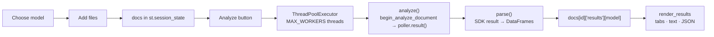

# 📄 Azure Document Intelligence Studio

A lightweight **Streamlit** app for trying Azure AI Document Intelligence's prebuilt models. Pick a model, drop in one or more documents, and see the original document beside its extracted data as tables, plain text and downloadable JSON.

```
Choose model  →  Add documents  →  Analyze  →  Review results
```

## ✨ Features

- **Two-column workspace:** controls (model, upload, file queue) on the left, split view on the right with the original document beside the extracted data.
- **Step tracker** across the top that advances as you add files and get results.
- **5 prebuilt models:** Invoice, Receipt, Read (OCR), Layout, and General Document (key-value pairs).
- **Drag-and-drop zone** with pill badges for the size limit and accepted file types.
- **File queue** with thumbnail cards, size, a status bar (staged / analyzed / failed) and a remove button for each file.
- **Multi-file upload** with duplicate detection (files are identified by a SHA-1 content hash).
- **Floating Analyze button** that only appears while there are documents waiting to be analyzed.
- **Parallel analysis:** several documents are sent to Azure at once (configurable with `MAX_WORKERS`).
- **Per-model result cache:** results are stored per document and per model, so switching documents never triggers a new API call.
- **Document preview** rendered with PyMuPDF (first 10 pages, with a fallback for plain images).
- **Result tabs** tailored to each model, with confidence shown as progress bars, plus raw **Text** and **JSON** tabs and a JSON download button.
- **Error handling per document:** one failing file doesn't stop the rest of the batch.
- **Changing the model resets the page**, so you always start clean.

## 🧠 Supported models

| UI label | Azure `model_id` | Add-on features | Result tabs |
|---|---|---|---|
| Prebuilt Invoice | `prebuilt-invoice` | none | Fields, Line items |
| Prebuilt Receipt | `prebuilt-receipt` | none | Fields, Line items |
| Prebuilt Read | `prebuilt-read` | none | Lines, Paragraphs, Words, Languages |
| Prebuilt Layout | `prebuilt-layout` | none | Paragraphs, Tables, Selection marks |
| Prebuilt General Document | `prebuilt-layout` | `KEY_VALUE_PAIRS` | Key-value pairs, Tables, Paragraphs |

> In API v4 the old `prebuilt-document` model is deprecated and replaced by **Layout + the key-value-pairs add-on** (`features=keyValuePairs`), which is what the *General Document* option runs.

Every model also gets **Text** and **JSON** tabs.

**Accepted file types:** `pdf`, `jpg`, `jpeg`, `png`, `bmp`, `tiff`, `tif`, `heif`, `docx`, `xlsx`, `pptx`, `html`

Office and HTML files (`docx`, `xlsx`, `pptx`, `html`) can be analyzed, but they have no page preview.

## 🚀 Getting started

### Prerequisites

- Python 3.9+
- An Azure **Document Intelligence** resource (endpoint + key)

### Install

```bash
git clone https://github.com/<your-username>/<your-repo>.git
cd <your-repo>/Azure-DI

python -m venv .venv
source .venv/bin/activate        # Windows: .venv\Scripts\activate

pip install -r requirements.txt
```

`requirements.txt` needs **Streamlit 1.40 or newer**, because the layout styling relies on keyed containers. `pymupdf` is optional: without it the app still works, but PDFs won't preview and thumbnails fall back to a file-type badge.

### Configure

Copy `env.example` to `.env` **next to `app.py`** and fill in your values:

```env
DOCUMENTINTELLIGENCE_ENDPOINT=https://<your-resource>.cognitiveservices.azure.com/
DOCUMENTINTELLIGENCE_API_KEY=<your-key>
```

The alternative names `AZURE_DOCUMENT_INTELLIGENCE_ENDPOINT` and `AZURE_DOCUMENT_INTELLIGENCE_KEY` are also accepted. The app reads credentials from the environment only: if they are missing, the left panel shows an error and the Analyze button is disabled until you set them and restart.

> ⚠️ Never commit your `.env` file. The included `.gitignore` already excludes it.

**Recommended:** the styling assumes a light theme. Create `.streamlit/config.toml` next to `app.py` so a dark OS theme doesn't clash:

```toml
[theme]
base = "light"
```

### Run

```bash
streamlit run app.py
```

## 🖱️ How to use

1. **Choose a model** from the dropdown in the left panel. The model ID and a short description appear under it.
2. **Add documents** by dragging files onto the drop zone or clicking Browse. Each file appears in the queue with a thumbnail. Use ✕ to remove one, or **Remove all**.
3. **Click the floating Analyze button** at the bottom right. It shows how many documents are waiting, for example "Analyze 3 documents". To re-run documents that already have results for this model, tick *Re-analyze…* under **Options**.
4. **Review results** on the right: the original on the left, extracted data on the right. With several files, use the **Viewing** dropdown to switch between them.

## 🗂️ Code structure

The whole app lives in a single file, `app.py`:

```
.
├── .gitignore
├── README.md
└── Azure-DI/
    ├── app.py             # the entire Streamlit app
    ├── env.example        # copy to .env and fill in
    └── requirements.txt
```

### Layout of `app.py`

| Section | What it contains |
|---|---|
| **Config** | Imports, optional PyMuPDF import, `.env` loading, `env()` helper, `ENV_ENDPOINT` / `ENV_KEY` |
| **`MODELS`** | Config dict for the 5 models: `model_id`, `features`, `tabs`, `help` |
| **Constants** | `ALLOWED_TYPES`, `NO_PREVIEW_TYPES`, `MAX_WORKERS`, `STEPS` |
| **Azure helpers** | `get_client()`, `analyze()` |
| **Parsing helpers** | `_conf()`, `_val()`, `table_to_df()`, `parse()` |
| **Styling** | One `CSS` block (design tokens, step tracker, drop zone, queue cards, floating button) |
| **UI helpers** | `fmt_size()`, `ext_of()`, `stepper_html()`, `page_images()`, `thumbnail()`, `show_preview()`, `show_df()`, `render_results()`, `empty_state()` |
| **State** | `st.session_state` setup (`docs`, `uploader_key`, `view_doc`, `toast`) and the `reset_page()` callback |
| **Left panel** | Model selector, drop zone, format badges, file queue, credentials warning, Options |
| **Right panel** | Document selector and the split view (original / extracted data) |
| **Step tracker state** | Works out the current step and fills the tracker |
| **Floating Analyze button** | Pending-document count, the button, and the parallel analysis loop |

### Data flow



### Session state shape

```python
st.session_state.docs = {
    "<sha1[:12]>": {
        "name": "invoice.pdf",
        "data": b"...",                          # raw file bytes
        "size": 123456,
        "results": {"Prebuilt Invoice": {...}},  # parsed output, keyed by model label
        "errors":  {"Prebuilt Receipt": "..."},  # error message, keyed by model label
    }
}
```

`view_doc` holds the id of the document shown in the split view, and `uploader_key` is bumped after each upload so the drop zone clears.

## ⚙️ Customization

**Add or change a model:** add an entry to `MODELS`:

```python
"Prebuilt ID Document": {
    "model_id": "prebuilt-idDocument",
    "features": [],
    "tabs": ["Fields"],          # must match keys of the `sections` dict in parse()
    "help": "Identity documents: name, date of birth, document number...",
},
```

**Tune parallelism:** change `MAX_WORKERS` (default `4`). Lower it if you hit `429` rate-limit errors.

**Change preview size:** adjust `max_pages` (default `10`) and `dpi` (default `110`) in `page_images()`. Queue thumbnails use `dpi=36` in `thumbnail()`.

**Change the look:** colors live in the `:root` variables at the top of the `CSS` block.

## 💳 Pricing tier and limits

This resource runs on the **S0 Standard** tier. Things to know:

- The **training API** (used to build custom models) is limited to **1 call per minute**. This app only calls the *analyze* API with prebuilt models, so that limit doesn't affect it. Keep it in mind if you extend the project with custom model training.
- Analyze calls have their own rate limits. If you see `429` errors on large batches, lower `MAX_WORKERS`.
- Add-on features can be billed separately from the base model, so a *General Document* run (Layout + key-value pairs) may cost more than a plain *Layout* run. Check the Azure pricing page for current rates.
- For current file-size, page-count and quota numbers, see the [Azure docs](https://learn.microsoft.com/azure/ai-services/document-intelligence/).

## ⚠️ Notes

- Password-protected PDFs aren't supported.
- Documents and results are kept **in memory** for the current browser session only. Nothing is written to disk.
- Streamlit state is only written from the main thread. Worker threads only call Azure and parse the result.
