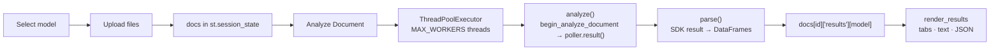

# 📄 Azure Document Intelligence Studio

A lightweight **Streamlit** app for trying Azure AI Document Intelligence's prebuilt models. Upload one or more documents, pick a model, and get structured results as tables, plain text, and downloadable JSON, with a page preview next to them.

```
Select model  →  Upload documents  →  Analyze  →  Preview & structured results
```

## ✨ Features

- **5 prebuilt models:** Invoice, Receipt, Read (OCR), Layout, and General Document (key-value pairs).
- **Multi-file upload** with duplicate detection (files are identified by a SHA-1 content hash).
- **Parallel analysis:** several documents are sent to Azure at once (configurable with `MAX_WORKERS`).
- **Per-model result cache:** results are stored per document and per model, so switching tabs never triggers a new API call.
- **Document preview** rendered with PyMuPDF (first 10 pages, with a fallback for plain images).
- **Result tabs** tailored to each model, plus raw **Text** and **JSON** tabs with a JSON download button.
- **Error handling per document:** one failing file doesn't stop the rest of the batch.
- **Changing the model resets the page**, so you always start clean.

## 🧠 Supported models

| UI label | Azure `model_id` | Add-on features | Result tabs |
|---|---|---|---|
| Prebuilt Invoice | `prebuilt-invoice` | none | Fields, Line items |
| Prebuilt Receipt | `prebuilt-receipt` | none | Fields, Line items |
| Prebuilt Read | `prebuilt-read` | none | Lines, Paragraphs, Words, Languages |
| Prebuilt Layout | `prebuilt-layout` | none | Paragraphs, Tables, Selection marks |
| Prebuilt General Document | `prebuilt-layout` | `KEY_VALUE_PAIRS` | Key-value pairs, Tables, Paragraphs |

> In API v4 the old `prebuilt-document` model is replaced by **Layout + the key-value-pairs add-on**, which is what the *General Document* option runs.

Every model also gets **Text** and **JSON** tabs.

**Accepted file types:** `pdf`, `jpg`, `jpeg`, `png`, `bmp`, `tiff`, `tif`, `heif`

## 🚀 Getting started

### Prerequisites

- Python 3.9+
- An Azure **Document Intelligence** resource (endpoint + key)

### Install

```bash
git clone https://github.com/<your-username>/<your-repo>.git
cd <your-repo>

python -m venv .venv
source .venv/bin/activate        # Windows: .venv\Scripts\activate

pip install streamlit pandas python-dotenv pymupdf azure-ai-documentintelligence azure-core
```

`pymupdf` is optional. Without it the app still works, but the preview falls back to showing the raw image (and PDFs won't preview).

### Configure

Create a `.env` file **next to `app.py`**:

```env
DOCUMENTINTELLIGENCE_ENDPOINT=https://<your-resource>.cognitiveservices.azure.com/
DOCUMENTINTELLIGENCE_API_KEY=<your-key>
```

The alternative names `AZURE_DOCUMENT_INTELLIGENCE_ENDPOINT` and `AZURE_DOCUMENT_INTELLIGENCE_KEY` are also accepted. If no `.env` is found, paste the endpoint and key into the sidebar instead.

> ⚠️ Never commit your `.env` file. Add it to `.gitignore`.

### Run

```bash
streamlit run app.py
```

## 🖱️ How to use

1. **Select a model** from the dropdown. The model ID and a short description appear under it.
2. **Upload documents** (drag and drop, any number of files). Use ✕ to delete one, or **Delete all**.
3. **Choose documents** in the multiselect and click **Analyze Document**. Tick *Re-analyze…* to force a new run for documents that already have results.
4. **Review results** in the expander for each document: preview on the left, result tabs on the right.

## 🗂️ Code structure

The whole app lives in a single file, `app.py`, organized into clearly separated sections:

```
.
├── app.py          # the entire Streamlit app
├── .env            # your Azure endpoint + key (not committed)
└── README.md
```

### Layout of `app.py`

| Section | What it contains |
|---|---|
| **Config** | Imports, optional PyMuPDF import, `.env` loading, `env()` helper, `ENV_ENDPOINT` / `ENV_KEY` |
| **`MODELS`** | Config dict for the 5 models: `model_id`, `features`, `tabs`, `help` |
| **Constants** | `ALLOWED_TYPES`, `MAX_WORKERS` |
| **Azure helpers** | `get_client()`, `analyze()` |
| **Parsing helpers** | `_conf()`, `_val()`, `table_to_df()`, `parse()` |
| **UI helpers** | `fmt_size()`, `page_images()`, `show_preview()`, `render_results()` |
| **State** | `st.session_state` setup (`docs`, `uploader_key`, `selected`, `toast`) |
| **Sidebar** | Azure connection inputs |
| **Step 1** | Model selector + `reset_page()` callback |
| **Step 2** | File uploader, duplicate detection, delete controls |
| **Step 3** | Document selection, **Analyze** button, parallel analysis loop |
| **Step 4** | Per-document preview and results |

### Data flow



### Session state shape

```python
st.session_state.docs = {
    "<sha1[:12]>": {
        "name": "invoice.pdf",
        "data": b"...",                       # raw file bytes
        "size": 123456,
        "results": {"Prebuilt Invoice": {...}},   # parsed output, keyed by model label
        "errors":  {"Prebuilt Receipt": "..."},   # error message, keyed by model label
    }
}
```

## ⚙️ Customization

**Add or change a model:** add an entry to `MODELS`:

```python
"Prebuilt ID Document": {
    "model_id": "prebuilt-idDocument",
    "features": [],
    "tabs": ["Fields"],          # must match keys of the `sections` dict in parse()
    "help": "Identity documents: name, date of birth, document number...",
},
```

**Tune parallelism:** change `MAX_WORKERS` (default `4`). Lower it if you hit `429` rate-limit errors, especially on the Free tier.

**Change preview size:** adjust `max_pages` (default `10`) and `dpi` (default `110`) in `page_images()`.

## ⚠️ Notes & limits

- The **Free (F0)** tier has stricter file-size, page, and rate limits than Standard (S0). See the [Azure docs](https://learn.microsoft.com/azure/ai-services/document-intelligence/) for current numbers.
- Password-protected PDFs aren't supported.
- Documents and results are kept **in memory** for the current browser session only. Nothing is written to disk.
- Streamlit state is only written from the main thread. Worker threads only call Azure and parse the result.
